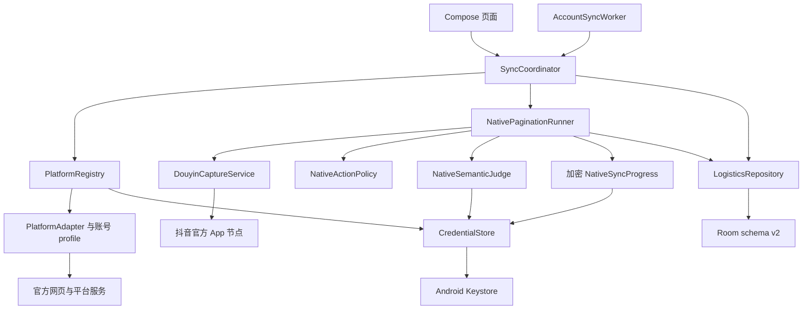

# 架构说明

## 组件与数据流

`LogisticsApplication` 创建 `AppContainer`，完成中断恢复、原生进度恢复、profile 清理及后台安排后完成 `ready`。前台和后台执行等待初始化。`AppContainer` 的内部独立数据库入口用于真实副本验收，生产入口保持默认自动更新行为。

平台读取和解析、Repository 事务及合并、Coordinator 执行和进度分别维护。平台真实可用范围见[验收记录](acceptance.md)。

## 业务模型与事务

| 类型 | 作用 |
| --- | --- |
| `Account` | 平台、账号名称、profile、启用及移除状态、执行状态、错误、成功与尝试时间、captureMode 和 externalIdentity |
| `Order` | 按账号及真实平台编号保存标题、状态、下单时间和来源入口 |
| `Shipment` | 承运商、运单、状态、取件信息、预计送达、更新时间、备注、归档及图像 |
| `SourceRef` | 关联账号、订单及包裹，保留平台订单和包裹标识、来源名称与入口 |
| `TrackingEvent` | 包裹、时间、轨迹正文和状态 |
| `ShipmentAlias` | 包裹合并后的旧编号关联 |
| `TrackingQueue` | 网页来源待查询项、请求时间、尝试时间和错误 |
| `PendingProfileCleanup` | 等待清理的账号 profile |

`ingest` 在事务中保存订单、来源及对应查询项。`applyTrackingAndFinish` 原子保存物流结果并移除来源查询项；失败或取消保留查询进度。有效承运商编码和运单一致时按已有规则合并包裹，保留来源、轨迹及用户字段。订单、来源和轨迹使用稳定标识，重复读取保持幂等。

备注及归档更新在事务中解析别名。账号移除后保留已导入业务资料，同时清理该账号的待查询项、凭据、profile、原生进度与可归属的原生证据目录。经过已确认类型过滤的订单由 `excludedRemoteIds` 进入 Repository 清理；共享包裹仍有其他来源时保留。

首次导入已签收订单使用九十天范围，已导入记录持续保留。网页平台对缺少日期的处理沿用现有规则；抖音首次导入已签收订单必须取得含年份的下单时间及普通配送依据。明确签收状态和较新事件按现有传播规则维护；缺少真实异常或时间比较样本的情况继续记录未验证。

## 网页会话与同步恢复

每个账号使用独立 `profileName`。创建 WebView 后在导航前绑定 profile，登录、订单和物流读取共用对应 CookieManager。网页消息限定官方 HTTPS 来源及主 frame；JSON 使用 kotlinx.serialization，网络使用 OkHttp。结构不支持、登录、安全验证和明确服务失败通过 `AppFailure` 分类展示。

`SyncCoordinator` 共用账号锁及活动任务，生产期限八分钟。重新读取列表后优先处理开始时已有的查询项。账号自身期限到达或资料未完成时使用 `PARTIAL`；普通取消继续传播 `CancellationException`。成功时间只在满足完整完成条件时更新。

启动恢复将残留 `SYNCING` 改为 `PARTIAL` 并补齐查询进度。启动时把未删除的 DOUYIN WEB 账号规范为 APP_PAGE；网页同步与账号更新只处理 WEB 账号并排除 DOUYIN。前台按十五分钟节流更新网页账号，三十分钟后台更新默认关闭；APP_PAGE 账号需要前台采集，不参与网页自动更新。

账号移除会取消任务并清理查询项、凭据、浏览数据与可归属的原生证据目录；未加载的 profile 在移除时直接删除，已加载 profile 的实际删除需要后续进程处理。不同用户账号、共享来源及部分清理分支的真实验收范围以记录为准。

## 抖音订单、物流及分页

固定导航由 App 内部 `NativePaginationRunner` 执行。账号页取得完整抖音号并核查绑定；订单详情取得真实订单编号，列表位置、标题和节点路径仅用于定位。业务保存再次核查账号有效状态、绑定标识及订单归属。

`ingestNativeOrders` 限定空 shipments；`ingestNativeLogistics` 保存已确认运单、规范化承运商及有效轨迹，不增加原生查询队列。物流关联由同轮目标详情的实际跳转建立；页面提供编号时必须一致。无年份物流时间使用同一订单下单时间至扫描时间的唯一区间推定，时区 `Asia/Shanghai`；不能唯一确定时保留诊断资料。

分页进度由 `NativeSyncProgress` 按账号和抖音号隔离，使用 CredentialStore、kotlinx.serialization 及 AtomicFile 加密保存。业务事务成功返回后保存完成标记。继续采集生成新 captureId，从官方入口重新核查账号和真实编号，稳定标识处理重复读取。恢复采集清空本轮 blocker、把上一轮 blocker 保存到 previousBlocked 并生成新 cycleId；本轮未再出现的订单标为 stale。完成判定要求本轮订单 finished 或 stale，同时列表结束、范围确认、结束证据存在且没有当前 blocker。抖音待发货订单纳入导入范围，要求订单编号、状态与普通配送依据，不读取物流。

只有平台明确结束、目标均已保存或明确排除且没有必需字段缺失时才能设置 `READY`。当前账号完整列表结束尚未确认，相关任务保持 `PARTIAL`。

## Jev 辅助与资源释放

App 设置中配置的 Jev 凭据使用 `native.jev.key` 加密保存，`nativeJevEnabled` 默认 false。`NativeSemanticJudge` 固定调用 `jev-1.14.0`，判断商品区域及物流正文；固定标签由程序核查。请求仅发送公共标签和必要结构，完整私人字段保存在本机。

每个请求十秒、每轮最多一百次，概率至少0.95并通过当前官方窗口、节点和范围检查才采用。`NativeActionPolicy` 同时检查实际父节点及手势目标；禁止交易操作。正常触摸导航期间停止自动点击，恢复后重新核查页面。结束、取消及期限到达时释放模型请求、账号任务和本服务请求的触摸模式。

开发阶段的 Jev 文档辅助使用固定四分类，保存输入、概率及逐项核查结果；构建、数据库比较、签名和验收结论使用工具及原始资料。请求和缓存、耗时、tokens、费用及不确定项分别记录。T15 小规模结果不能证明整体提速。

无障碍服务启用配置和实际连接分别检查。跨安装、跨 instrumentation 进程的自动重连仍未解决。

## 隐私与证据

凭据、原生进度及最近采集资料使用 Android Keystore 加密，网页会话保存在账号 profile。业务资料使用 Room，系统备份及设备迁移规则排除应用数据。原生采集默认只保存进度与每轮汇总；设置中的“记录完整采集诊断资料”开启后才保存扫描、事件、动作、耗时与分页资料。证据目录保留最近 3 轮并清理超过 7 天的目录，启动、开始采集与结束时执行；新采集在目录内写入加密账号标记，账号移除删除该账号的可归属目录，无法归属的旧目录继续按全局保留规则处理。完整账号、运单、地址和采集原文保存在本机忽略目录，普通日志及公开文档仅保留必要结果。

阶段验证使用真实资料及独立数据库名称。副本、源码、签名、安装指纹和完整日志通过阶段索引关联；通过、失败、中断、跳过和未运行分别记录。
