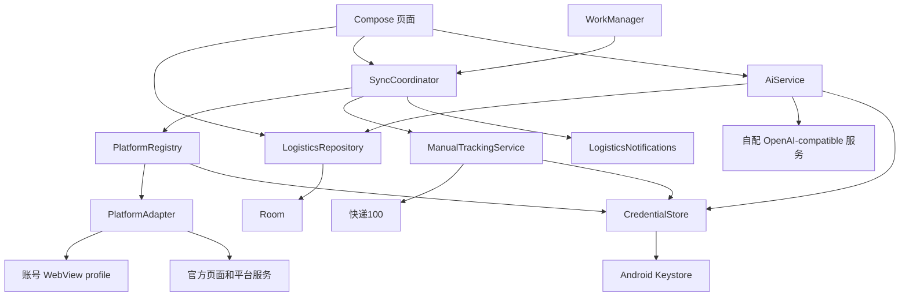
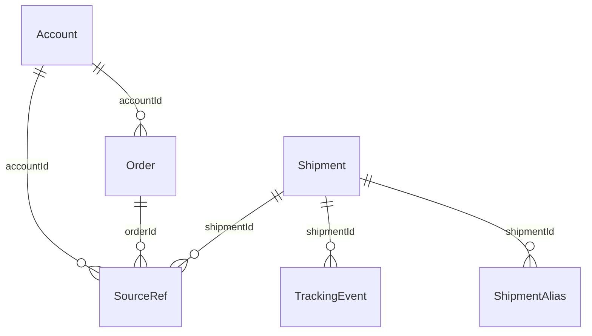

# 架构说明

## 组成与调用

`AppContainer` 创建 Room、设置、凭据、平台、快递100、AI、通知及同步对象。Compose 页面观察 Room 与设置的 Flow，前台操作和 WorkManager 均调用 `SyncCoordinator`。

主要目录：`model/` 保存业务类型；`data/` 保存 Room、关联处理、设置与凭据；`platform/` 保存官方网页、profile、响应采集及适配器；`network/` 保存快递100和 AI；`sync/` 保存更新、后台任务与通知；`ui/` 保存页面与主题。

## 数据模型

| 类型 | 用途与关联 |
| --- | --- |
| `Account` | 平台、显示名称、独立 `profileName`、启用状态、同步状态、错误及最近成功时间；移除后保留记录并标记 `deleted` |
| `Order` | 使用 `accountId` 与平台订单标识关联，保存商品标题、状态、创建时间及网页入口 |
| `Shipment` | 保存公司、运单、状态、取件信息、预计送达、时间、备注、归档状态及加密查询电话 |
| `SourceRef` | 关联 `Order`、`Shipment`、平台、账号和平台包裹标识，保留来源名称与订单入口 |
| `TrackingEvent` | 关联包裹，保存时间、轨迹正文和平台提供的状态 |
| `ShipmentAlias` | 包裹合并后将旧标识关联到当前包裹，支持已打开详情与旧通知入口 |
| `Report` | 保存包裹问答与物流日报正文、生成时间和类型 |

关联由 Repository 维护。模型允许一个订单关联多个包裹，一个包裹保留多个来源；具体平台的多个包裹映射需要真实响应验证。待发货订单可以没有包裹，包裹页通过 `observeUnshippedOrders()` 显示状态为 `WAITING_SHIPMENT` 且尚无 `SourceRef` 的订单。

## 导入、合并与保留

订单标识由账号标识和平台订单标识生成；来源标识进一步包含平台包裹标识。有效公司编码与运单一致时合并包裹，保留全部来源，迁移轨迹及旧标识，合并备注、归档状态、取件信息、预计送达、图像、加密电话和最近查询时间。

`ingest()`、`applyTracking()` 和手动包裹创建使用 Room transaction。使用旧包裹标识读取详情、来源、轨迹和修改备注、归档时解析 `ShipmentAlias`；写入备注与归档时将解析和写入放在同一 transaction。轨迹按包裹标识、时间和正文生成标识，重复导入更新相同记录。

首次导入已完成订单时，已知创建时间必须处于最近 90 天；创建时间缺失时当前保留该订单。已经导入的订单持续更新，即使创建时间已经超过 90 天。京东通过真实响应中的 `submitDate` 读取创建时间，格式为 `yyyy-MM-dd HH:mm:ss`；其他部分平台尚未取得创建时间。最近 90 天完整范围尚未完成验收。同步不会按日期删除已有订单与包裹；用户备注和归档状态在再次导入时保留。

京东“充值成功”订单使用空 `shipments` 保存。已完成且没有物流的订单，只有其既有来源关联的包裹同时缺少运单与轨迹时才传播终态；保留已有记录、来源、备注和归档状态，不创建物流轨迹。有运单或轨迹的包裹继续由真实物流更新维护。

物流状态使用已有最大轨迹时间与新轨迹时间比较，较早轨迹不覆盖较新的物流状态。没有明确状态、取件信息或预计送达时，保留本地已有值。首次创建尚无轨迹的包裹使用当前时间记录更新。

## 平台与账号会话

`PlatformAdapter` 提供登录页面、订单页面、允许的来源、分页同步和轨迹查询。`PlatformRegistry` 统一打开登录、订单及账号配置。购物平台使用官方网页会话；淘宝部分请求通过 OkHttp，Cookie 从对应账号 profile 读取并写回。

京东和拼多多从订单页面响应读取订单并从物流页面读取轨迹。京东真实登录和 19 条订单导入已确认，拼多多真实登录及两次返回 0 条订单的同步已确认。京东“完成／充值成功”状态、创建时间及官方订单、充值与物流详情来源处理已在实现中，最新完整同步复验尚未完成。拼多多有订单时的分页、关联和轨迹尚未验证。

淘宝读取 MTOP 订单及物流页面数据。小米配置页面提供网页登录、设备标识读取和短信绑定入口，通过智能助理服务会话与已绑定手机号发起列表和轨迹请求。抖音提供登录、订单入口和响应采集，订单及轨迹映射尚未完成真实响应确认。这三个平台尚未完成真实验收。

每个账号的 `profileName` 以 `account_` 开头，使用 AndroidX WebKit multi-profile 绑定 WebView。创建 WebView 时检查 `MULTI_PROFILE`、`DOCUMENT_START_SCRIPT`、`WEB_MESSAGE_LISTENER`、`GET_COOKIE_INFO` 和 `DELETE_BROWSING_DATA`。缺少能力时显示更新 Android System WebView 的提示。

消息监听仅接受当前适配器列出的 HTTPS 官方来源及主 frame。WebView 禁用文件访问、内容访问和混合内容。document-start script 采集网页提供的响应及页面信息，通过 kotlinx.serialization 处理 JSON。未知业务结构报告 `UNSUPPORTED_RESPONSE`，账号登录或验证要求分别报告 `NEEDS_LOGIN` 和 `NEEDS_VERIFICATION`。

账号移除时标记 `deleted`、取消活动任务和后台任务，关闭正在使用的 WebView，清除浏览数据与 `account.<id>.` 凭据。加载过的 profile 名称保存在待删除列表，下次进程启动调用 `deleteProfile()`；未加载的 profile 可以直接删除。业务记录与来源保留。Repository 在保存账号和写入平台轨迹时检查移除状态。

已执行的会话隔离测试使用真实已登录京东账号与新建未登录 profile，确认认证 Cookie 独立，并确认移除未登录 profile 后真实京东 Cookie 保留。跨平台会话测试已经加入源码，尚未运行；两个不同用户账号的订单归属和重启后的 profile 删除尚未验证。

## 更新、期限与通知

`SyncCoordinator` 按账号使用 Mutex，前台和后台共用账号同步流程。同步阶段包含订单导入、轨迹更新、完成、失败及取消；进度中包含账号、已导入订单数、已更新包裹数和总数，数据事件携带本次订单批次。Room 保存同步状态及最近成功时间。

账号和手动批量同步执行期限为 8 分钟。购物网页订单加载期限为 90 秒、轨迹页面为 45 秒；HTTP 请求使用客户端期限。WebView 在结束、取消和超时时关闭。进程启动将被中断的 `SYNCING` 状态显示为需要重新更新。

每个启用账号对应一个 30 分钟 PeriodicWorkRequest，手动包裹共用一个后台任务，均要求网络连接。默认刷新未归档且未签收的包裹。WorkManager 服从 Android 系统调度，30 分钟表示任务安排间隔，设备限制可能延迟运行。

日报使用按日期命名的 OneTimeWorkRequest，在运行后安排下一天。配置变更取消旧日报计划并安排新时间；默认采用设备当地时间 20:00。

通知比较同步前后的状态、取件码与最近轨迹事件。已发送标识保存在 SharedPreferences，由包裹、状态、轨迹事件与取件码组成。通知分别进入包裹详情、账号操作页面和助手页面。Android 13 及以上需要通知权限。

## 外部服务与隐私

快递100通过 OkHttp 发送表单，`param` 使用 kotlinx.serialization 序列化，签名与提交使用同一个 JSON 字符串。查询前校验公司、运单、手机号和服务配置，记录请求尝试后调用服务；同一公司与运单至少间隔 30 分钟，失败请求也占用间隔。批量更新继续处理其余包裹，并最终报告取得的首个服务或网络失败。API 业务错误按明确状态显示，未知响应结构立即报告。

`AiService` 通过 Chat Completions 请求自配服务，支持 HTTP／HTTPS，HTTP 的发送内容在配置页说明。自动摘要包括商品、公司、来源平台、状态、时间、时区、取件信息存在状态、轨迹数量、最近轨迹时间及无包裹待发货订单；排除登录凭据、账号名称、运单、取件码、取件地址和轨迹正文。问题和标题中的已知运单、已知取件地址、电话号码和已配置服务凭据会被隐藏。用户输入的未知地址仍需要在输入时排除。

Android Keystore 提供 AES/GCM 密钥，`CredentialStore` 加密保存账号配置及服务凭据。查询电话号码以加密文本存入 Room。WebView 浏览数据由各 profile 保存。系统备份和设备迁移规则排除全部应用数据。

平台最近采集的完整响应在本机账号凭据存储中加密保存，账号移除时一并清除。导出诊断用于记录结构、响应状态、正文长度和去查询参数的 endpoint，测试资料只保存经过隐私处理的内容。
