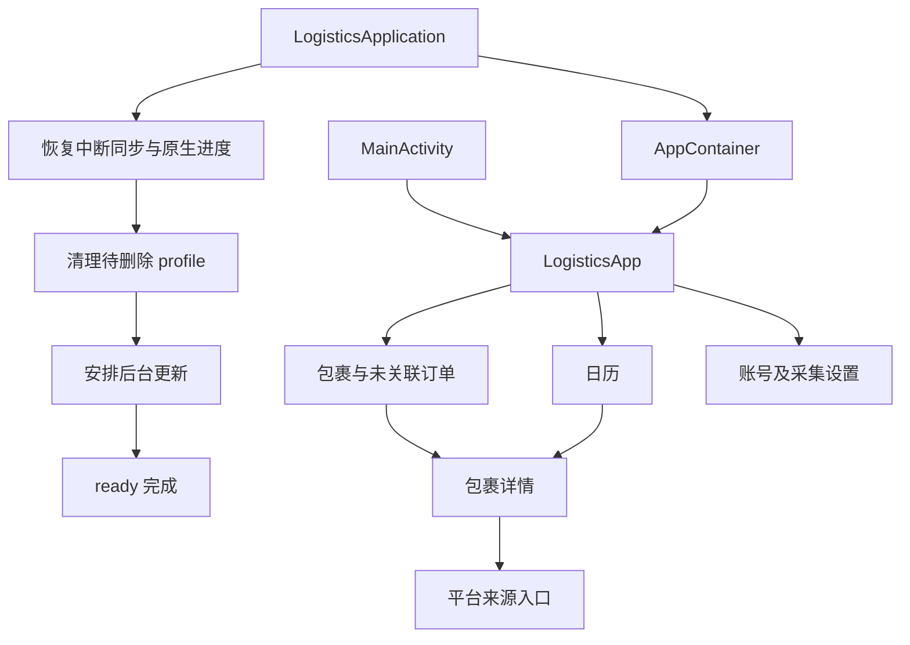
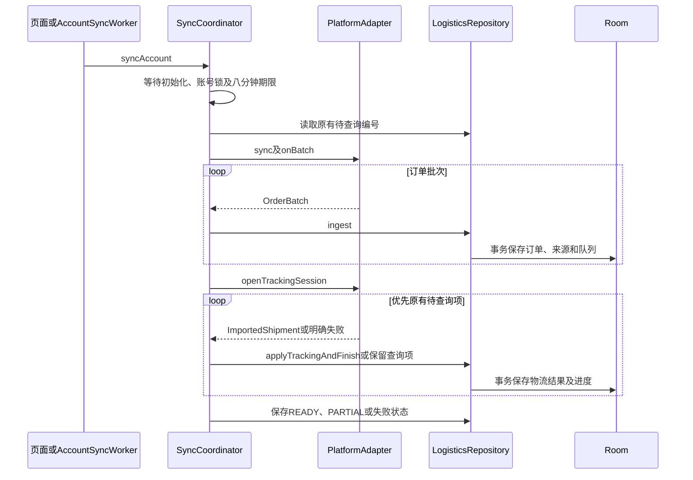
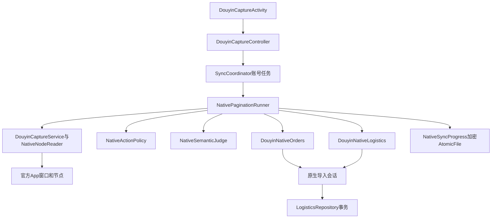
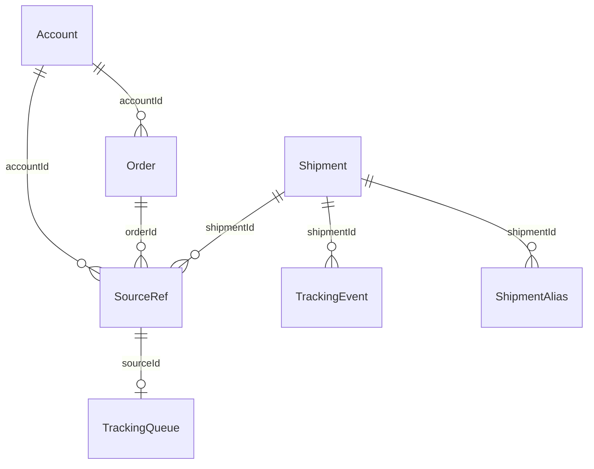

# 项目关系图与源码导航

产品与构建入口见[README](../README.md)，数据规则见[架构说明](architecture.md)，当前真实范围见[验收记录](acceptance.md)。本机有 `.codegraph/` 时，理解或定位代码优先使用[CodeGraph](codegraph.md)。

2026-11-23 完成 P0 基线回归；后续按[开发计划与恢复入口](development-plan.md)的 P1 至 P7 执行。当前版本 1.1.0、versionCode 2、Room schema v2；Kotlin 源码 71 份（main 42、单元测试 5、设备测试 24）。

## 启动与页面

Application、Activity、账号页面和 Worker 共用生产容器。T14 独立副本验收使用内部容器配置，关闭该宿主的自动更新。页面观察 Room 和设置 Flow，界面中的保存操作通过实际 Repository 执行。

## 网页账号更新

京东和拼多多的网页读取位于 `BrowserAdapters.kt`，淘宝位于 `TaobaoAdapter.kt`；账号 profile 及官方来源检查由平台模块维护。

## 抖音采集

固定流程进入首页、商城、我的订单及全部，逐项核查真实订单编号。原生订单与物流分别提交；继续采集重新核查账号和页面。Jev 判断用途，程序检查控制实际动作。完整分页、部分样本及服务自动重连的未完成范围继续保留。

## 数据关系

业务关联由 Repository 维护；待发货及抖音未关联订单可以没有包裹，多个来源可以关联同一包裹。别名维护合并前编号。账号移除保留业务记录，明确类型排除通过 Repository 清理来源和独立包裹。

## 源码入口

| 行为 | 入口 |
| --- | --- |
| 初始化及共享对象 | [LogisticsApplication.kt](../app/src/main/java/com/logisticsmanagement/app/LogisticsApplication.kt)、[AppContainer.kt](../app/src/main/java/com/logisticsmanagement/app/AppContainer.kt) |
| 页面导航与状态 | [MainActivity.kt](../app/src/main/java/com/logisticsmanagement/app/MainActivity.kt)、[LogisticsApp.kt](../app/src/main/java/com/logisticsmanagement/app/ui/LogisticsApp.kt) |
| 包裹和来源详情 | [ShipmentsScreen.kt](../app/src/main/java/com/logisticsmanagement/app/ui/ShipmentsScreen.kt)、[ShipmentDetailScreen.kt](../app/src/main/java/com/logisticsmanagement/app/ui/ShipmentDetailScreen.kt) |
| 日历和设置 | [CalendarScreen.kt](../app/src/main/java/com/logisticsmanagement/app/ui/CalendarScreen.kt)、[SettingsScreen.kt](../app/src/main/java/com/logisticsmanagement/app/ui/SettingsScreen.kt) |
| 业务类型及Room | [Models.kt](../app/src/main/java/com/logisticsmanagement/app/model/Models.kt)、[LogisticsDatabase.kt](../app/src/main/java/com/logisticsmanagement/app/data/LogisticsDatabase.kt)、[schema2](../app/schemas/com.logisticsmanagement.app.data.LogisticsDatabase/2.json) |
| 事务及合并 | [LogisticsRepository.kt](../app/src/main/java/com/logisticsmanagement/app/data/LogisticsRepository.kt) |
| 平台及账号会话 | [PlatformAdapter.kt](../app/src/main/java/com/logisticsmanagement/app/platform/PlatformAdapter.kt)、[PlatformRegistry.kt](../app/src/main/java/com/logisticsmanagement/app/platform/PlatformRegistry.kt)、[PlatformWebView.kt](../app/src/main/java/com/logisticsmanagement/app/platform/PlatformWebView.kt) |
| 网页读取与解析 | [BrowserAdapters.kt](../app/src/main/java/com/logisticsmanagement/app/platform/BrowserAdapters.kt)、[TaobaoAdapter.kt](../app/src/main/java/com/logisticsmanagement/app/platform/TaobaoAdapter.kt)、[CaptureScripts.kt](../app/src/main/java/com/logisticsmanagement/app/platform/CaptureScripts.kt) |
| 原生采集入口与服务 | [DouyinCaptureActivity.kt](../app/src/main/java/com/logisticsmanagement/app/platform/DouyinCaptureActivity.kt)、[DouyinCaptureService.kt](../app/src/main/java/com/logisticsmanagement/app/platform/DouyinCaptureService.kt) |
| 原生分页、进度及动作 | [NativePaginationRunner.kt](../app/src/main/java/com/logisticsmanagement/app/platform/NativePaginationRunner.kt)、[NativeSyncProgress.kt](../app/src/main/java/com/logisticsmanagement/app/platform/NativeSyncProgress.kt)、[NativeActionPolicy.kt](../app/src/main/java/com/logisticsmanagement/app/platform/NativeActionPolicy.kt) |
| 原生字段及导入 | [DouyinNativeOrders.kt](../app/src/main/java/com/logisticsmanagement/app/platform/DouyinNativeOrders.kt)、[DouyinNativeLogistics.kt](../app/src/main/java/com/logisticsmanagement/app/platform/DouyinNativeLogistics.kt)、[NativeOrderImportSession.kt](../app/src/main/java/com/logisticsmanagement/app/platform/NativeOrderImportSession.kt)、[NativeLogisticsImportSession.kt](../app/src/main/java/com/logisticsmanagement/app/platform/NativeLogisticsImportSession.kt) |
| Jev结构化判断 | [NativeSemanticJudge.kt](../app/src/main/java/com/logisticsmanagement/app/platform/NativeSemanticJudge.kt) |
| 执行及后台 | [SyncCoordinator.kt](../app/src/main/java/com/logisticsmanagement/app/sync/SyncCoordinator.kt)、[SyncProgress.kt](../app/src/main/java/com/logisticsmanagement/app/sync/SyncProgress.kt)、[Workers.kt](../app/src/main/java/com/logisticsmanagement/app/sync/Workers.kt) |
| 加密及配置 | [CredentialStore.kt](../app/src/main/java/com/logisticsmanagement/app/data/CredentialStore.kt)、[SettingsStore.kt](../app/src/main/java/com/logisticsmanagement/app/data/SettingsStore.kt) |
| 真实验证源码 | [androidTest](../app/src/androidTest/java/com/logisticsmanagement/app)、[单元测试](../app/src/test/java/com/logisticsmanagement/app) |

修改源码后执行 `codegraph sync`，平台可用范围更新需要真实证据及验收记录。完整本机阶段资料通过任务状态和证据索引查找。
