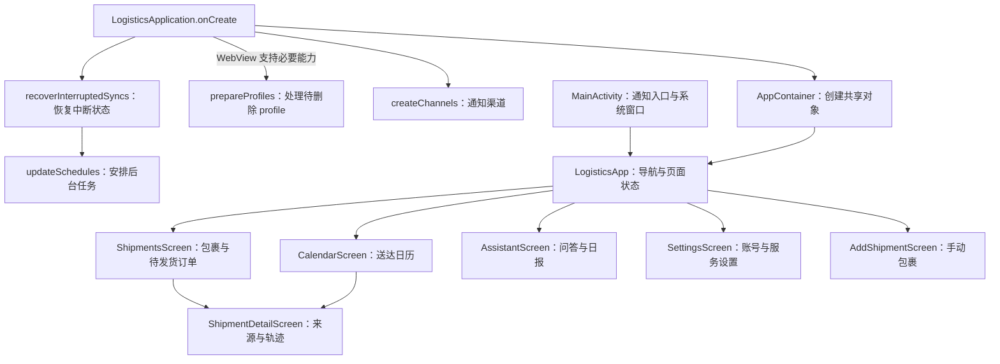
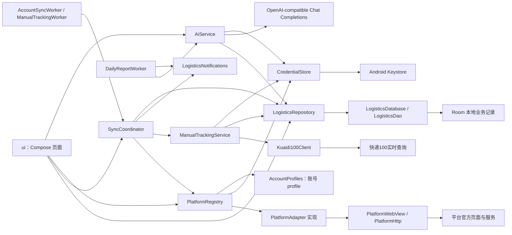
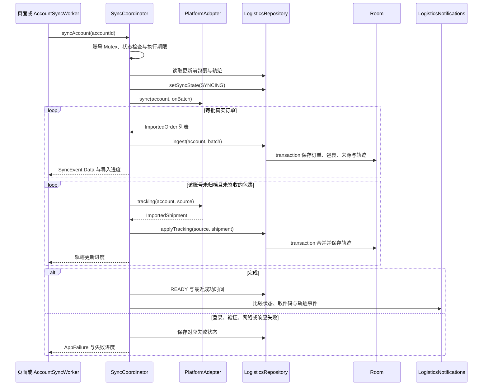
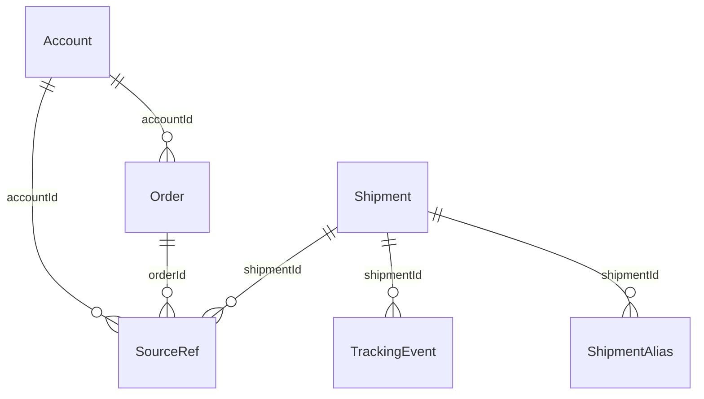
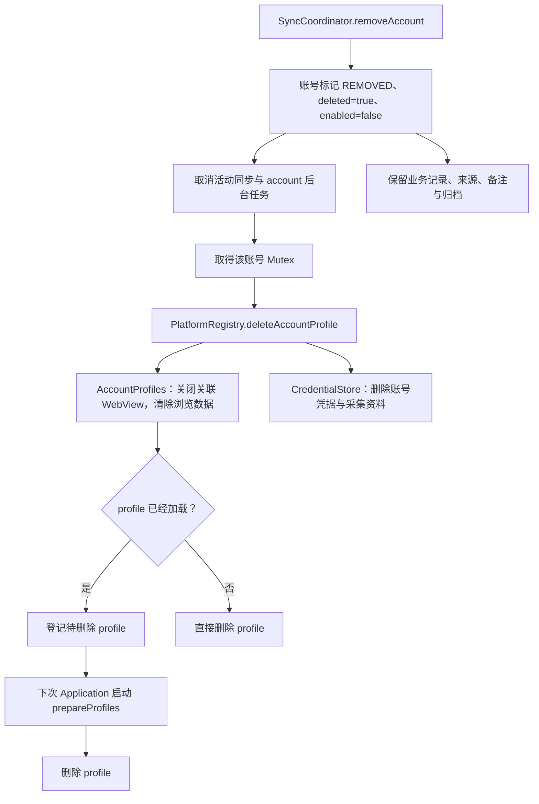

# 项目关系图与源码导航

阅读产品和构建入口使用 [README](../README.md)，阅读当前可用范围使用[验收记录](acceptance.md)。本文件的图描述当前源码中的组成与流程；数据处理规则、期限和隐私说明见[架构说明](architecture.md)，符号级查询见[CodeGraph 使用说明](codegraph.md)。

## 应用启动与页面

`AppContainer` 由 Application 创建，Activity、平台账号页面和 Worker 取得同一组共享对象。Compose 页面观察 Room 和设置的 Flow。通知通过 `shipmentId` 或 `destination` 进入包裹、账号设置或助手页面。

## 模块之间的关系

箭头表示调用、读取或写入，图中的 service 和 adapter 名称均对应当前源码。

`PlatformRegistry` 注册 `XiaomiAdapter`、`TaobaoAdapter`、`JdAdapter`、`PddAdapter` 和 `DouyinAdapter`。`PlatformAdapter` 定义分页同步、轨迹读取、官方来源与页面地址；打开登录和订单页面的操作由 `PlatformRegistry` 管理。抖音响应映射尚未完成，其他平台的真实验证范围分别记载在验收记录中。

## 一次账号同步

账号同步执行期限为 8 分钟。分页中已经导入的记录保存在本地；后续失败会记录失败状态。前台和后台共用该流程。手动包裹通过 `syncManual()` 调用 `ManualTrackingService`，使用同一公司与运单的 30 分钟查询间隔。

## 订单与包裹的关系

这些是 Repository 维护的业务关联。待发货订单可以没有 `SourceRef`，一个订单可以关联多个包裹，一个包裹可以保存多个平台来源。手动包裹使用 `MANUAL` 来源，与购物平台账号订单分别处理。

`ingest()` 使用账号与平台订单标识保存 `Order`；有效快递公司编码和运单相同时合并 `Shipment`。`SourceRef` 保留账号、订单和平台包裹标识，`ShipmentAlias` 将合并前的包裹标识关联到当前包裹。`TrackingEvent` 按包裹、时间和正文识别重复记录。详细规则和最近 90 天范围见架构说明。

## 账号移除与会话

登录、同步和打开订单使用账号所属的同一 profile。网页脚本消息只接收对应官方 HTTPS 来源和主 frame。账号凭据与采集响应由 Keystore 加密保存，业务记录由 Room 保存；AI 从业务记录生成经过隐私处理的摘要。具体发送内容见 README 的 AI 配置与隐私说明。

## 按任务寻找源码

| 要理解的行为 | 源码入口 |
| --- | --- |
| 应用初始化与共享对象 | [LogisticsApplication.kt](../app/src/main/java/com/logisticsmanagement/app/LogisticsApplication.kt)、[AppContainer.kt](../app/src/main/java/com/logisticsmanagement/app/AppContainer.kt) |
| 通知页面入口与导航 | [MainActivity.kt](../app/src/main/java/com/logisticsmanagement/app/MainActivity.kt)、[LogisticsApp.kt](../app/src/main/java/com/logisticsmanagement/app/ui/LogisticsApp.kt) |
| 包裹搜索、筛选与手动添加 | [ShipmentsScreen.kt](../app/src/main/java/com/logisticsmanagement/app/ui/ShipmentsScreen.kt) |
| 来源、物流、备注与归档 | [ShipmentDetailScreen.kt](../app/src/main/java/com/logisticsmanagement/app/ui/ShipmentDetailScreen.kt) |
| 日历、助手与设置 | [CalendarScreen.kt](../app/src/main/java/com/logisticsmanagement/app/ui/CalendarScreen.kt)、[AssistantScreen.kt](../app/src/main/java/com/logisticsmanagement/app/ui/AssistantScreen.kt)、[SettingsScreen.kt](../app/src/main/java/com/logisticsmanagement/app/ui/SettingsScreen.kt) |
| 业务类型与表结构 | [Models.kt](../app/src/main/java/com/logisticsmanagement/app/model/Models.kt)、[LogisticsDatabase.kt](../app/src/main/java/com/logisticsmanagement/app/data/LogisticsDatabase.kt)、[Room schema](../app/schemas/com.logisticsmanagement.app.data.LogisticsDatabase/1.json) |
| 数据导入、合并与来源保留 | [LogisticsRepository.kt](../app/src/main/java/com/logisticsmanagement/app/data/LogisticsRepository.kt) |
| 平台接口、账号与页面 | [PlatformAdapter.kt](../app/src/main/java/com/logisticsmanagement/app/platform/PlatformAdapter.kt)、[PlatformRegistry.kt](../app/src/main/java/com/logisticsmanagement/app/platform/PlatformRegistry.kt) |
| WebView、profile 与认证 | [PlatformWebView.kt](../app/src/main/java/com/logisticsmanagement/app/platform/PlatformWebView.kt)、[PlatformBrowserActivity.kt](../app/src/main/java/com/logisticsmanagement/app/platform/PlatformBrowserActivity.kt) |
| 京东、拼多多与抖音 | [BrowserAdapters.kt](../app/src/main/java/com/logisticsmanagement/app/platform/BrowserAdapters.kt)、[CaptureScripts.kt](../app/src/main/java/com/logisticsmanagement/app/platform/CaptureScripts.kt) |
| 淘宝与小米 | [TaobaoAdapter.kt](../app/src/main/java/com/logisticsmanagement/app/platform/TaobaoAdapter.kt)、[XiaomiAdapter.kt](../app/src/main/java/com/logisticsmanagement/app/platform/XiaomiAdapter.kt)、[XiaomiAccountActivity.kt](../app/src/main/java/com/logisticsmanagement/app/platform/XiaomiAccountActivity.kt) |
| 同步、后台安排与进度 | [SyncCoordinator.kt](../app/src/main/java/com/logisticsmanagement/app/sync/SyncCoordinator.kt)、[Workers.kt](../app/src/main/java/com/logisticsmanagement/app/sync/Workers.kt)、[SyncProgress.kt](../app/src/main/java/com/logisticsmanagement/app/sync/SyncProgress.kt) |
| 通知去重与跳转 | [LogisticsNotifications.kt](../app/src/main/java/com/logisticsmanagement/app/sync/LogisticsNotifications.kt) |
| 手动物流、快递100与公司编码 | [ManualTrackingService.kt](../app/src/main/java/com/logisticsmanagement/app/network/ManualTrackingService.kt)、[Kuaidi100Client.kt](../app/src/main/java/com/logisticsmanagement/app/network/Kuaidi100Client.kt)、[CarrierCodes.kt](../app/src/main/java/com/logisticsmanagement/app/network/CarrierCodes.kt) |
| AI 请求与隐私处理 | [AiService.kt](../app/src/main/java/com/logisticsmanagement/app/network/AiService.kt) |
| 凭据加密与设置 | [CredentialStore.kt](../app/src/main/java/com/logisticsmanagement/app/data/CredentialStore.kt)、[SettingsStore.kt](../app/src/main/java/com/logisticsmanagement/app/data/SettingsStore.kt) |
| HTTP 与 JSON | [HttpTransport.kt](../app/src/main/java/com/logisticsmanagement/app/network/HttpTransport.kt)、[PlatformHttp.kt](../app/src/main/java/com/logisticsmanagement/app/platform/PlatformHttp.kt)、[PlatformJson.kt](../app/src/main/java/com/logisticsmanagement/app/platform/PlatformJson.kt) |
| 单元与真机验证源码 | [IdentityTest.kt](../app/src/test/java/com/logisticsmanagement/app/IdentityTest.kt)、[androidTest](../app/src/androidTest/java/com/logisticsmanagement/app) |

修改入口、业务模型或同步流程时，更新相应关系图和说明，并执行 `codegraph sync` 更新本机索引。平台可用状态的变化需要真实验证证据并更新验收记录。
